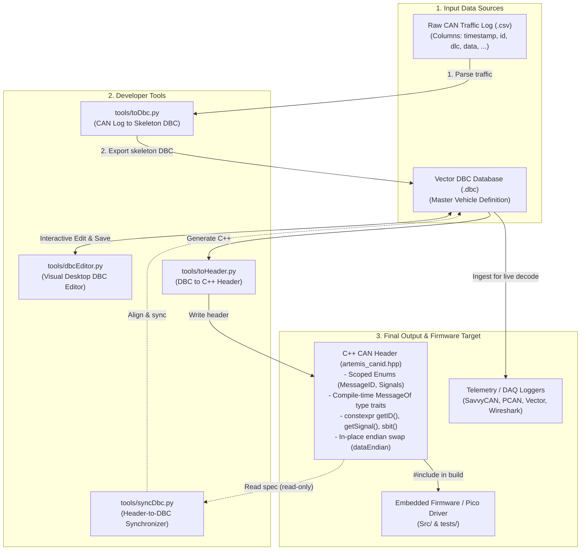

# CAN Tools & Header Generation Pipeline

This directory contains Python utilities for managing Vector DBC CAN databases, reverse-engineering CAN traffic logs, and generating type-safe, compile-time C++ header files (`Inc/artemis_canid.hpp`) for embedded systems (such as the RP2350b).

---

## Architecture & Pipeline Diagram

The flowchart below shows the streamlined DBC-first workflow:



---

## Tool Reference

### 1. `tools/dbcEditor.py` — Visual Vector DBC GUI Editor

A native desktop GUI application (using `tkinter` and `cantools`) to visually inspect, create, edit, search, and save Vector `.dbc` CAN database files.

* **Key Features**:
  * **Two-Pane Layout**: Message browser on the left with instant live search/filtering; signal inspector, layout table, and DBC comments on the right.
  * **Full Message Management**:
    * Add new CAN messages (Standard 11-bit or Extended 29-bit IDs in hex or decimal).
    * Edit existing messages (rename, reassign ID, change payload DLC, update sender node, adjust transmission cycle times).
    * Delete unwanted or obsolete messages with confirmation.
    * Collision detection preventing duplicate message IDs or duplicate message names.
  * **Full Signal Management**:
    * Add signals specifying start bit, bit length, byte order (Intel little-endian vs. Motorola big-endian), signed/unsigned representation, scale factor, offset, physical units, and description.
    * Double-click any signal to edit its properties in a modal dialog.
    * Delete signals with keyboard shortcut (`Delete` key) or toolbar button.
    * Collision detection preventing duplicate signal names within a message.
  * **Cycle Time Handling**: Preserves and updates `GenMsgCycleTime` attribute definitions.
  * **Complex DBC Compatibility**: Safely loads and writes large, multiplexed automotive DBC databases (such as diagnostic UDS/OBD-II message definitions).
  * **Automatic C++ Header Generation on Save**:
    * Saving the database (`Ctrl+S` or 💾 Save) automatically compiles and updates `Inc/artemis_canid.hpp`, ensuring firmware definitions always stay in lockstep with the DBC without requiring a separate button.
    * Custom export paths remain available via `File -> Export C++ Header As...` (`Ctrl+G`).
    * Can also run headlessly from the CLI via `--header` flag without launching the GUI.
  * **Cross-Platform & Headless Safe**: Runs on Windows, macOS, and Linux; core model (`DbcModel`) has zero GUI dependencies for headless CI/CD test automation.
  * **Keyboard Shortcuts**: `Ctrl+N` (New), `Ctrl+O` (Open), `Ctrl+S` (Save & Auto-Generate Header), `Ctrl+Shift+S` (Save As), `Ctrl+G` (Export Header As), `Delete` (Delete selected message/signal).
* **CLI Syntax**:
  ```bash
  python tools/dbcEditor.py [file.dbc] [--header [output_header.hpp]]
  ```
* **Examples**:
  ```bash
  # Open editor with an empty database
  python tools/dbcEditor.py

  # Open the Artemis vehicle master DBC in the GUI
  python tools/dbcEditor.py "tools/PSR Artemis27.dbc"

  # Compile C++ header directly from CLI (without opening GUI)
  python tools/dbcEditor.py "tools/PSR Artemis27.dbc" --header Inc/artemis_canid.hpp
  ```

---

### 2. `tools/toHeader.py` — DBC to C++ CAN Header Generator

Translates a Vector `.dbc` CAN database into a zero-allocation, compile-time C++ header (`artemis_canid.hpp`).

* **Input Support**:
  * Reads standard Vector `.dbc` files directly (via `cantools` with `strict=False` to handle multiplexed and diagnostic frames).
* **Generated C++ Features**:
  * **Type-Safe Enums**: Scoped enums for `MessageID`, message-specific signals (e.g. `BmsSignal` and alias `BmsSafetyCriticalSignal`), and bit flags.
  * **Compile-Time Trait Validation**: `MessageOf<SignalEnum>` template enforces at compile time that signals cannot be retrieved using the wrong message ID.
  * **Zero-Overhead Accessors**: `constexpr` functions `getID()`, `getMessageDefinition()`, `getSignal()`, `getBitPosition()`, and `sbit()`.
  * **Endian Normalization**: `dataEndian()` and `dataEndianFlip()` for in-place byte reversal on big-endian signals in the RX/TX buffer.
* **CLI Syntax**:
  ```bash
  python tools/toHeader.py <input.dbc> [output.hpp] [--array-name <name>] [--vehicle-only]
  ```
* **Example**:
  ```bash
  # Generate directly from the vehicle master DBC
  python tools/toHeader.py "tools/PSR Artemis27.dbc" Inc/artemis_canid.hpp
  ```

---

### 3. `tools/syncDbc.py` — Header-to-DBC Synchronizer

Synchronizes a Vector `.dbc` database with the vehicle CAN specifications from `Inc/artemis_canid.hpp` (read-only).

* **What It Does**:
  * Aligns all 18 canonical vehicle CAN messages (`BmsSafetyCritical`, `MotorControllerId`, `MotorBusVoltageCurrent`, etc.) with their exact IDs, names, cycle times, and descriptions.
  * Synchronizes all signal start bits, bit lengths, and byte order (Motorola big-endian vs. Intel little-endian).
  * Automatically builds Vector DBC value tables (`VAL_`) from bitfield enums (`BmsDtcFlags1`, `McLimitFlags`, `DistroControl`, etc.).
  * Preserves all additional diagnostic and hardware messages (e.g. WaveSculptor debug registers and Orion UDS diagnostic frames).
  * Preserves DBC attribute definitions (`GenMsgCycleTime`) and node definitions (`OrionBMS2`, `WaveSculptor22`, etc.).
* **CLI Syntax**:
  ```bash
  python tools/syncDbc.py [target.dbc] [--header Inc/artemis_canid.hpp]
  ```
* **Example**:
  ```bash
  python tools/syncDbc.py "tools/PSR Artemis27.dbc" --header Inc/artemis_canid.hpp
  ```

---

### 4. `tools/toDbc.py` — Log to DBC Skeleton

Reverse-engineers a Vector DBC file directly from recorded bus traffic logs.

* **Primary Use Case**: You captured bus traffic from a hardware bus sniffer into a CSV log and need a starter DBC database.
* **What It Does**:
  * Extracts unique CAN IDs and detects standard vs. extended frames.
  * Calculates transmission intervals (`cycle_time` in ms) using the median timestamp difference between consecutive frames.
  * Sets message length (DLC) based on the maximum payload size observed.
  * Populates placeholder 8-bit unsigned signals (`B0` through `B7`) for every byte.
* **CLI Syntax**:
  ```bash
  python tools/toDbc.py <input_log.csv> [output.dbc] [--decimal-ids]
  ```
* **Example**:
  ```bash
  python tools/toDbc.py bus_log.csv bus_skeleton.dbc
  ```

---

## Common Workflows

### Workflow A: Visual DBC Authoring &rarr; C++ Firmware Header

Use this for daily vehicle development, adding new sensor frames, or adjusting signal scaling:

```bash
# Step 1: Open the vehicle master DBC in the visual editor to add or edit messages/signals:
python tools/dbcEditor.py "tools/PSR Artemis27.dbc"

# Step 2: Compile the DBC into the type-safe C++ firmware header:
python tools/toHeader.py "tools/PSR Artemis27.dbc" Inc/artemis_canid.hpp
```

---

### Workflow B: Reverse Engineering Hardware Bus Captures &rarr; DBC &rarr; Firmware

Use this when capturing traffic from physical vehicle testing or third-party ECUs:

```bash
# Step 1: Convert raw CSV packet sniffer log to a starter DBC
python tools/toDbc.py bus_log.csv bus_skeleton.dbc

# Step 2: Open bus_skeleton.dbc in the visual DBC editor to name signals and assign units
python tools/dbcEditor.py bus_skeleton.dbc

# Step 3: Generate the C++ header directly from the refined DBC
python tools/toHeader.py bus_skeleton.dbc Inc/artemis_canid.hpp
```

---

### Workflow C: Synchronizing DBC from C++ Firmware Header

Use this when updating or aligning the Vector DBC from the firmware header (`Inc/artemis_canid.hpp`):

```bash
# Synchronize master vehicle DBC from artemis_canid.hpp (read-only):
python tools/syncDbc.py "tools/PSR Artemis27.dbc" --header Inc/artemis_canid.hpp
```

---

## Environment & Prerequisites

* **Python 3.10+**
* **cantools**: Required by `dbcEditor.py`, `syncDbc.py`, `toDbc.py`, and `toHeader.py`:
  ```bash
  pip install cantools
  ```
  *(If using the workspace virtual environment, `.venv\Scripts\python.exe` is already pre-configured with `cantools`.)*
